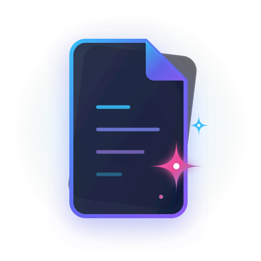

# DokAI — Intelligent Technical Documentation Studio

<p align="center">
  
</p>

<p align="center">
  <strong>A high-performance, local-first technical documentation studio with runnable code environments, multi-model AI synthesis, and drop-in i18n support.</strong>
</p>

<p align="center">
  
  
  
  
  
</p>

---

## ✨ Features

- **100% Local-First & Offline:** All documents, settings, and API keys are stored locally in your browser storage (`localStorage`). Zero external telemetry or tracking.
- **Multi-Tab Workspace:** Chrome-style tabs with smooth bidirectional drag-and-drop reordering.
- **Docs Drawer & Instant Filter:** Collapsible documents bar with category pills and live full-text search.
- **Runnable Code Sandboxes:** Test and execute code directly inside documentation across multiple programming languages.
- **Winget Auto-Installer:** Detects missing compilers/runtimes and provides one-click native installation via Windows Package Manager.
- **AI Documentation Suite:**
  - **Generator:** Creates structured, multi-section guides with strict Markdown fidelity.
  - **Enhancer:** Enhances single sections or entire documents with deep code examples and security considerations.
  - **Auditor:** Scans documents for technical inaccuracies, scores health (0-100), and suggests fixes.
- **Background Tasks Queue:** Non-blocking async AI tasks with live progress indicators and automatic cleanup.
- **Universal Typography & Themes:** Use any system font, Google Font, or local font file (`.woff2`, `.ttf`) with OLED True Black theme.
- **Drop-in i18n Engine:** Add new languages simply by dropping a JSON file into the codebase.

---

## ⚡ Supported Code Environments

| Language | Environment / Runtime | Missing Toolchain Installer |
| :--- | :--- | :--- |
| **Rust** | Native `rustc` / Rust Playground | `winget install -e --id Rustlang.Rustup` |
| **JavaScript / TypeScript** | Isolated Sandbox / Node.js / Bun | Built-in / `winget install -e --id OpenJS.NodeJS` |
| **Python** | Python 3 interpreter | `winget install -e --id Python.Python.3.12` |
| **Go** | Golang toolchain | `winget install -e --id GoLang.Go` |
| **C / C++** | GCC / MinGW-w64 | `winget install -e --id BrechtSanders.WinLibs.POSIX.UCRT` |
| **PowerShell** | Windows PowerShell / PS Core | Native system host |
| **Windows CMD / Batch** | Native Command Prompt | Native system host |

---

## 🤖 Supported AI Providers

DokAI connects directly via client-side HTTPS to official LLM endpoints:
- **Google Gemini:** `gemini-2.5-flash`, `gemini-2.5-pro`
- **Anthropic Claude:** `claude-3-5-sonnet`, `claude-3-haiku`
- **OpenAI:** `gpt-4o`, `gpt-4o-mini`, `o1`
- **OpenRouter:** Any open-source or commercial model ID (DeepSeek, Llama 3, Mistral, etc.)
- **Custom Model ID:** Enter any specific model ID directly in Settings.

---

## 📦 Import & Export Formats

DokAI provides one-click export and flexible import:

### Export Formats
1. **Standalone Markdown (`.md`):** Standard GitHub-flavored Markdown with frontmatter.
2. **Single-File Web HTML (`.html`):** Zero-dependency offline web page with interactive Table of Contents, syntax highlighting, and dark mode.
3. **Single Document JSON (`.json`):** Portable document file containing all metadata and sections.
4. **Full Library Backup (`.json`):** Complete archive of all studio documents.

### Single Document JSON Structure
```json
{
  "id": "doc-rust-guide",
  "title": "Rust Concurrency Guide",
  "description": "Threads, channels, and async Tokio runtime.",
  "version": "1.0.0",
  "category": "Systems",
  "tags": ["rust", "async", "tokio"],
  "sections": [
    {
      "id": "sec-1",
      "title": "1. Threads & Fearless Concurrency",
      "slug": "threads-fearless-concurrency",
      "order": 1,
      "content": "## 1. Threads\n\n```rust\nuse std::thread;\nfn main() {\n    thread::spawn(|| println!(\"Worker thread\")).join().unwrap();\n}\n```"
    }
  ]
}
```

### Full Library Backup JSON Structure
```json
{
  "app": "DokAI",
  "version": "1.0.0",
  "exportedAt": "2026-11-09T00:00:00.000Z",
  "documents": [ /* Array of document objects */ ]
}
```

---

## 🌐 Localization (i18n)

DokAI uses a drop-in reactive localization engine:

### Adding a New Language
1. Create a new JSON file in `src/lib/i18n/locales/<lang_code>.json` (e.g. `de.json`, `es.json`, `fr.json`).
2. Copy the key structure from [`src/lib/i18n/locales/en.json`](src/lib/i18n/locales/en.json) and translate the values.
3. Vite automatically detects and registers the new language at build time. No code modifications needed!

Alternatively, users can click **Settings → Language → Import Language (.json)** to load a language file at runtime.

### Locale File Skeleton
```json
{
  "_meta": {
    "code": "en",
    "name": "English",
    "nativeName": "English",
    "flag": "🇬🇧"
  },
  "common": { "close": "Close", "cancel": "Cancel", "save": "Save", "delete": "Delete" },
  "titlebar": { "aiGenerator": "AI Generator", "search": "Search", "tasks": "Tasks" },
  "docsBar": { "title": "DOCUMENTS", "newBtn": "New", "searchPlaceholder": "Search..." },
  "sidebar": { "sections": "SECTIONS", "addSection": "Add Section" },
  "editor": { "editMode": "Edit", "previewMode": "Preview", "enhanceThisDoc": "Enhance This Doc" },
  "toolbar": { "bold": "Bold", "codeBlock": "Code Block", "table": "Table" },
  "aiModal": { "title": "AI Documentation Generator", "generateBtn": "Generate Documentation" },
  "enhanceModal": { "title": "AI Documentation Enhancer", "applyBtn": "Apply Enhancements" },
  "auditModal": { "title": "AI Documentation Auditor", "applyFix": "Apply Fix" },
  "newDoc": { "title": "Create New Document", "createBtn": "Create Document" },
  "importExport": { "title": "Import / Export", "dragDrop": "Drag and drop JSON here" },
  "settings": { "title": "Settings", "apiKeyPlaceholder": "Enter API Key" },
  "runner": { "runCode": "Run Code", "installWithWinget": "Install via Winget" }
}
```

---

## ⌨️ Keyboard Shortcuts

| Shortcut | Action |
| :--- | :--- |
| `Ctrl + N` | Create New Document |
| `Ctrl + Shift + A` | Open AI Documentation Generator |
| `Ctrl + K` | Open Command Palette & Global Search |
| `Ctrl + Shift + S` | Open Settings |
| `Ctrl + Shift + E` | Open Import / Export Studio |
| `Ctrl + E` | Toggle Edit / Preview / Split Mode |
| `Ctrl + B` | Toggle Sections Sidebar |
| `Ctrl + S` | Save Active Document |
| `Ctrl + F` | Filter Documents in DocsBar |

---

## 🛠️ Development & Build

### Prerequisites
- [Bun](https://bun.sh/) (or Node.js 18+)
- [Rust & Cargo](https://www.rust-lang.org/) (1.78+)

### Commands
```bash
# Install dependencies
bun install

# Run desktop app in development
bun run tauri dev

# Run web frontend only
bun run dev

# Check types
bun run check

# Build desktop release installer (.exe / .msi)
bun run tauri build
```

---

## 🔒 Privacy & Security

- **Zero Cloud Storage:** Your notes and documents never leave your machine.
- **Direct HTTPS Calls:** LLM API keys are stored solely in your local storage and sent directly to the official provider endpoint.
- **Git Protected:** Sensitive files (`.env*`, `target/`, `node_modules/`) are strictly excluded in `.gitignore`.

---

## 📄 License

Distributed under the [MIT License](LICENSE).
