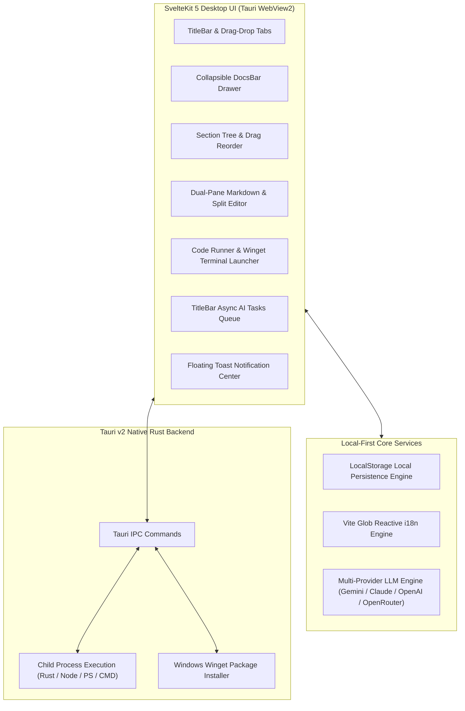
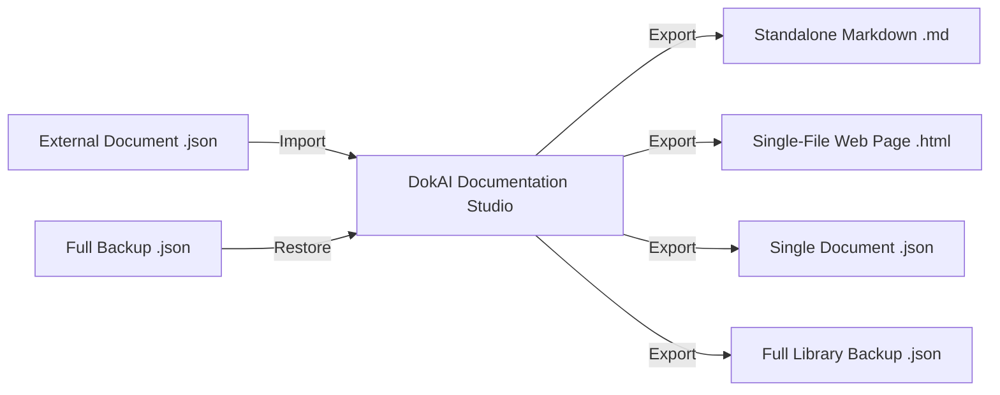

# DokAI — Intelligent Technical Documentation & Knowledge Studio

<p align="center">
  
</p>

<p align="center">
  <strong>A high-performance, developer-first, local-offline technical documentation studio equipped with runnable code environments, multi-provider AI synthesis, and an extensible drop-in i18n architecture.</strong>
</p>

<p align="center">
  
  
  
  
  
  
</p>

---

## 📖 Table of Contents
- [1. Overview & Purpose](#1-overview--purpose)
- [2. Core Architectural Highlights](#2-core-architectural-highlights)
  - [Local-First Privacy & Zero Telemetry](#-local-first-privacy--zero-telemetry)
  - [Multi-Tab Workspace & Bidirectional Drag-and-Drop](#-multi-tab-workspace--bidirectional-drag-and-drop)
  - [Interactive Multi-Language Code Runner & Winget Integration](#-interactive-multi-language-code-runner--winget-integration)
  - [Multi-Provider AI Documentation Suite](#-multi-provider-ai-documentation-suite)
  - [Background AI Tasks Queue & Floating Toast Center](#-background-ai-tasks-queue--floating-toast-center)
  - [Universal Typography & Theme Customization](#-universal-typography--theme-customization)
- [3. Import & Export Ecosystem](#3-import--export-ecosystem)
  - [Export Formats Overview](#export-formats-overview)
  - [External JSON Import Rules & Validation](#external-json-import-rules--validation)
  - [Single Document JSON Skeleton & Schema](#single-document-json-skeleton--schema)
  - [Full Library Backup JSON Skeleton & Schema](#full-library-backup-json-skeleton--schema)
- [4. Internationalization (i18n) & Adding New Languages](#4-internationalization-i18n--adding-new-languages)
  - [How Drop-In Localization Works](#how-drop-in-localization-works)
  - [Adding a New Language in 2 Minutes](#adding-a-new-language-in-2-minutes)
  - [Complete i18n JSON Skeleton Specification](#complete-i18n-json-skeleton-specification)
- [5. Keyboard Shortcuts Cheatsheet](#5-keyboard-shortcuts-cheatsheet)
- [6. Development & Build Instructions](#6-development--build-instructions)
- [7. Project Directory Structure](#7-project-directory-structure)
- [8. Security, Privacy & License](#8-security-privacy--license)

---

## 1. Overview & Purpose

**DokAI** is a desktop engineering application built with **Rust (Tauri v2)** and **Svelte 5 Runes** designed to modernize technical writing, system architecture authoring, and API reference management.

### Why DokAI?
Most modern documentation platforms suffer from network dependencies, slow web runtimes, lack of interactive code verification, and intrusive telemetry. DokAI eliminates these bottlenecks:
- **100% Local-First & Offline:** Your documents, custom code snippets, and API keys are stored solely in your local browser/desktop storage (`localStorage`). No cloud databases or tracking servers.
- **Runnable Documentation:** Test Rust, JavaScript, TypeScript, Python, Go, C++, PowerShell, and Batch scripts directly inside the documentation viewport.
- **State-of-the-Art AI Co-Pilot:** Built-in generative engines allow generating full-fledged technical specifications, enhancing code blocks, and running automated accuracy audits using Google Gemini, Anthropic Claude, OpenAI, or OpenRouter.
- **Minimal Resource Footprint:** Idle RAM consumption of ~35-50 MB with instantaneous cold start times powered by compiled Rust and fine-grained Svelte 5 reactive runes.

---

## 2. Core Architectural Highlights



### 🔒 Local-First Privacy & Zero Telemetry
DokAI operates under a strict privacy-first model. No analytical tracking, telemetry beacons, or third-party monitoring packages are installed. LLM API requests are sent directly via encrypted HTTPS from your machine to the chosen provider's official endpoint using the API keys you provide.

### 📑 Multi-Tab Workspace & Bidirectional Drag-and-Drop
- **Chrome-Style Tabs:** Open multiple technical documents simultaneously.
- **Bidirectional Drag-and-Drop:** Smooth reordering handles dragging tabs both left-to-right and right-to-left without animation jitter or layout jumping.
- **DocsBar (Document Drawer):** Collapsible left-side document navigator featuring real-time full-text search and category filter pills.
- **Section Tree (Sidebar):** Supports deep nested sections. Drag to reorder, add, rename, or delete sections with instant auto-save.

### ⚡ Interactive Multi-Language Code Runner & Winget Integration
Execute code snippets directly within your documentation:
- **Natively Supported:**
  - `Rust` (Native toolchain / Rust Playground sandbox)
  - `JavaScript` & `TypeScript` (Isolated in-app execution sandbox or Node.js/Bun)
  - `PowerShell` (Windows PowerShell / PS Core)
  - `Windows CMD & Batch` (Native CMD process host)
  - `Python` (Python 3.x)
  - `Go` (Golang toolchain)
  - `C` & `C++` (GCC / MinGW-w64)
- **Automatic Winget Toolchain Detection:**
  If a language compiler or runtime is missing on your Windows machine, DokAI automatically detects it and offers a one-click automated setup button utilizing the Windows Package Manager (`winget`):
  ```powershell
  # Go Toolchain
  winget install -e --id GoLang.Go

  # C++ MinGW-w64 Toolchain
  winget install -e --id BrechtSanders.WinLibs.POSIX.UCRT

  # Python Interpreter
  winget install -e --id Python.Python.3.12
  ```

### 🤖 Multi-Provider AI Documentation Suite
DokAI interfaces directly with top-tier artificial intelligence models:
- **Google Gemini:** `gemini-2.5-flash`, `gemini-2.5-pro`, etc.
- **Anthropic Claude:** `claude-3-5-sonnet`, `claude-3-haiku`, etc.
- **OpenAI:** `gpt-4o`, `gpt-4o-mini`, `o1`, etc.
- **OpenRouter:** Access to hundreds of open-weights models (DeepSeek, Llama 3, Mistral, Qwen).
- **Custom Model ID Support:** Type any newly released model string directly into the model selector.

#### 1. AI Document Generator
Converts any topic or system requirements into a production-ready, multi-section technical document adhering to a strict Markdown protocol:
- Clean hierarchical headings (`#`, `##`, `###`), structured tables, and language-tagged code blocks.
- Specialized templates: *API Reference, Engineering Guide, System Architecture, SDK Getting Started, Code-to-Doc Reverse Engineering, or Custom Prompt*.
- Dedicated target output language selector.

#### 2. Enhance This Doc (AI Section Enhancer)
Allows targeted rewriting of either an individual section or the entire document:
- Injects practical code examples and edge-case handling.
- Performs security validations and concurrency audits.
- Refines architectural diagrams and technical depth.

#### 3. AI Document Auditor
Scans existing documentation for technical inaccuracies, outdated syntax, or missing prerequisites:
- Generates a **Health Score (0 - 100)**.
- Categorizes findings by severity: *Critical*, *Inaccuracy*, *Warning*, and *Suggestion*.
- Enables one-click application of recommended fixes directly into the editor.

### 🔄 Background AI Tasks Queue & Floating Toast Center
- **Non-Blocking Execution:** When an AI generation or audit is in progress, you can safely close the modal and continue writing or browsing other documents.
- **TitleBar Tasks Dropdown:** Displays real-time progress percentages, task descriptions, and instant cancellation buttons.
- **Auto-Cleanup:** Completed tasks automatically clear from the queue after 15 seconds.
- **Floating Toast Center:** Non-intrusive alert toasts appear on the top-right. Toasts auto-dismiss after 30 seconds or can be closed immediately.

### 🎨 Universal Typography & Theme Customization
- **System Font Discovery:** Automatically enumerates and loads all fonts locally installed on your operating system.
- **Web & Custom File Fonts:** Load Google Fonts or upload local `.ttf`, `.otf`, `.woff`, or `.woff2` files.
- **High-Contrast Dark Theme:** True Black mode designed for OLED and high-refresh-rate displays.

---

## 3. Import & Export Ecosystem

DokAI ensures your data remains completely portable with zero vendor lock-in.



### Export Formats Overview
1. **Standalone Markdown (`dokai_<title>.md`):** Complete document exported as a clean, standardized GitHub-flavored Markdown file with frontmatter and dividers.
2. **Standalone Web HTML (`dokai_<title>.html`):** Zero-dependency single-file HTML document featuring a sticky sidebar Table of Contents (TOC), dark mode styling, responsive typography, and syntax highlighting. Ready for immediate static web deployment.
3. **Single Document JSON (`dokai_<title>.json`):** Portable, fully typed schema containing document metadata, categories, tags, and section contents.
4. **Full Library Backup (`dokai_full_backup_<date>.json`):** Complete archive of all documents in your studio.

---

### External JSON Import Rules & Validation

When importing an external JSON file into DokAI (via drag-and-drop or file picker), the import engine tolerates variations and supports three formats:
1. **A Single Document Object:** A JSON object with at least a `title` string and a `sections` array.
2. **A Backup Object:** A JSON object containing a `documents` array.
3. **An Array of Documents:** A plain JSON array `[ { ... }, { ... } ]`.

> [!TIP]
> If optional fields (such as `id`, `tags`, or `version`) are missing from your external JSON, DokAI automatically generates safe defaults without throwing errors.

---

### Single Document JSON Skeleton & Schema

Below is the exact JSON structure required to construct or programmatically generate a DokAI document:

```json
{
  "id": "doc-rust-concurrency-guide",
  "title": "Rust Concurrency & Async Runtime Guide",
  "description": "Comprehensive engineering guide to multi-threading, Tokio async runtimes, and synchronization primitives in Rust.",
  "version": "1.0.0",
  "category": "Systems Programming",
  "author": "Engineering Architecture Team",
  "icon": "🦀",
  "tags": [
    "rust",
    "concurrency",
    "tokio",
    "async",
    "systems"
  ],
  "createdAt": "2026-11-09T00:00:00.000Z",
  "updatedAt": "2026-11-09T00:00:00.000Z",
  "sections": [
    {
      "id": "sec-concurrency-intro",
      "title": "1. Threads & The Fearless Concurrency Model",
      "slug": "threads-fearless-concurrency",
      "order": 1,
      "content": "## 1. Threads & Fearless Concurrency\n\nRust guarantees memory safety across thread boundaries through the `Send` and `Sync` traits.\n\n```rust\nuse std::thread;\n\nfn main() {\n    let handle = thread::spawn(|| {\n        println!(\"Hello from worker thread!\");\n    });\n    handle.join().unwrap();\n}\n```"
    },
    {
      "id": "sec-async-tokio",
      "title": "2. Tokio Runtime & Task Scheduling",
      "slug": "tokio-runtime-scheduling",
      "order": 2,
      "content": "## 2. Tokio Runtime\n\nTokio uses a work-stealing multi-threaded scheduler for high-throughput I/O pipelines."
    }
  ]
}
```

#### Field Specifications:
| Field | Type | Required | Description |
| :--- | :--- | :---: | :--- |
| `id` | `string` | Optional | Unique document ID (e.g., `doc-my-guide`). Auto-generated if omitted. |
| `title` | `string` | **Yes** | Primary document display title. |
| `description`| `string` | Optional | Document summary or target audience description. |
| `version` | `string` | Optional | Document semantic version string (e.g., `"1.0.0"`). |
| `category` | `string` | Optional | Category name used for drawer filtering (e.g., `"API"`, `"Guides"`). |
| `author` | `string` | Optional | Author name or attribution (Defaults to `"AI Created"` for generated docs). |
| `icon` | `string` | Optional | Emoji or icon string representing the document. |
| `tags` | `string[]` | Optional | Search keywords and tags. |
| `sections` | `DocSection[]` | **Yes** | Ordered array of document sections. |
| `sections[].id` | `string` | Optional | Unique section ID (e.g., `"sec-intro"`). |
| `sections[].title`| `string` | **Yes** | Section navigation title. |
| `sections[].slug` | `string` | Optional | URL-friendly slug. |
| `sections[].order`| `number` | **Yes** | Integer defining section order (`1`, `2`, `3`...). |
| `sections[].content`| `string`| **Yes** | Section Markdown content. |

---

### Full Library Backup JSON Skeleton & Schema

To create a complete library backup or migrate from another knowledge management tool:

```json
{
  "app": "DokAI",
  "version": "1.0.0",
  "exportedAt": "2026-11-09T01:30:00.000Z",
  "documents": [
    {
      "id": "doc-01",
      "title": "DokAI Architectural Overview",
      "description": "System architecture, modules, and data flow.",
      "version": "1.0.0",
      "category": "Architecture",
      "tags": ["dokai", "architecture", "tauri"],
      "createdAt": "2026-11-09T00:00:00.000Z",
      "updatedAt": "2026-11-09T00:00:00.000Z",
      "sections": [
        {
          "id": "sec-overview",
          "title": "System Topology",
          "slug": "system-topology",
          "order": 1,
          "content": "# System Topology\n\nHigh-level architectural components."
        }
      ]
    }
  ]
}
```

---

## 4. Internationalization (i18n) & Adding New Languages

DokAI implements a lightweight, zero-dependency reactive i18n architecture built directly on Svelte 5 runes (`$state`, `$derived`).

### How Drop-In Localization Works
The translation registry automatically discovers any JSON locale file located in `src/lib/i18n/locales/` at compile time via Vite's `import.meta.glob`:
```typescript
const builtInModules = import.meta.glob('./locales/*.json', { eager: true });
```
This means **adding a new language requires zero TypeScript code modifications.**

---

### Adding a New Language in 2 Minutes

#### Method A: Drop-in Codebase File (For Developers & Contributors)
1. Navigate to [`src/lib/i18n/locales/`](file:///c:/Users/kasim/Desktop/dokai/src/lib/i18n/locales/).
2. Create a new file named `<language_code>.json` (e.g., `de.json`, `fr.json`, `es.json`, `ja.json`).
3. Copy the skeleton below, fill in the translations, and save.
4. Run `bun run dev` — your language is instantly available in the Settings language picker!

#### Method B: Runtime File Import (For End Users)
1. Open DokAI and click **Settings (⚙️)** in the TitleBar.
2. Select the **Language** tab.
3. Click **Import Language (.json)** and select your custom JSON file.
4. The new language is registered immediately in your local storage and set as active.

---

### Complete i18n JSON Skeleton Specification

Below is the complete, verbatim key schema representing every interface string in DokAI:

```json
{
  "_meta": {
    "code": "en",
    "name": "English",
    "nativeName": "English",
    "flag": "🇬🇧"
  },
  "common": {
    "close": "Close",
    "cancel": "Cancel",
    "delete": "Delete",
    "save": "Save",
    "loading": "Loading...",
    "error": "Error",
    "success": "Success"
  },
  "titlebar": {
    "aiGenerator": "AI Generator",
    "search": "Search",
    "tasks": "Tasks",
    "tasksHeader": "AI Tasks Queue",
    "tasksTooltip": "AI Background Tasks Queue",
    "taskDone": "Completed",
    "taskError": "Error",
    "noActiveTasks": "No active AI tasks right now.",
    "tasksHint": "You can start multiple AI tasks concurrently; completed tasks clear automatically after 15s.",
    "newManualDoc": "Create New Document Manually",
    "toggleDocsBar": "Toggle Documents Bar",
    "exportImport": "Export / Import",
    "library": "Library",
    "settings": "Settings",
    "openLibraryOrNew": "Create New Document Manually",
    "scrollLeft": "Scroll tabs left",
    "scrollRight": "Scroll tabs right",
    "closeTab": "Close Tab",
    "searchTooltip": "Quick Search & Command Palette (Ctrl+K)",
    "running": "running",
    "total": "total",
    "removeFromList": "Remove from list",
    "importExport": "Import / Export JSON & Backup",
    "settingsTooltip": "Settings & AI Model Providers",
    "minimize": "Minimize",
    "maximize": "Maximize / Restore",
    "closeWindow": "Close Window"
  },
  "docsBar": {
    "title": "DOCUMENTS",
    "newBtn": "New",
    "newDoc": "Create New Document Manually",
    "searchPlaceholder": "Search documents...",
    "categories": "CATEGORIES",
    "allCategories": "All",
    "noDocsFound": "No matching documents found.",
    "createFirstDoc": "Create your first document",
    "sectionsCount": "sections",
    "deleteDocConfirm": "Are you sure you want to delete this document?",
    "docDeleted": "Document deleted"
  },
  "sidebar": {
    "sections": "SECTIONS",
    "addSection": "Add Section",
    "sectionTitlePlaceholder": "Section Title",
    "deleteSection": "Delete Section",
    "collapseSidebar": "Collapse sidebar",
    "expandSidebar": "Expand sidebar",
    "moveUp": "Move Up",
    "moveDown": "Move Down"
  },
  "editor": {
    "editMode": "Edit",
    "previewMode": "Preview",
    "splitMode": "Split View",
    "wordCount": "Words",
    "charCount": "Characters",
    "readingTime": "min read",
    "enhanceThisDoc": "Enhance This Doc",
    "auditThisDoc": "Audit This Doc",
    "unsavedChanges": "Unsaved changes",
    "allChangesSaved": "All changes saved",
    "emptyContentPlaceholder": "Start typing your markdown here..."
  },
  "toolbar": {
    "bold": "Bold",
    "italic": "Italic",
    "heading": "Heading",
    "codeBlock": "Code Block",
    "inlineCode": "Inline Code",
    "quote": "Blockquote",
    "bulletList": "Bullet List",
    "numberedList": "Numbered List",
    "table": "Insert Table",
    "link": "Insert Link",
    "undo": "Undo",
    "redo": "Redo"
  },
  "aiModal": {
    "title": "AI Documentation Generator",
    "subtitle": "Specify topic, target audience, and architecture; AI crafts structured technical documentation.",
    "promptLabel": "Documentation Topic & Details",
    "promptPlaceholder": "e.g., Rust async/await architecture, Tokio runtime internals, and error management...",
    "templateType": "Template Type",
    "targetLanguage": "Output Language",
    "generateBtn": "Generate Documentation",
    "generating": "Generating...",
    "generatingBackground": "Generating in background..."
  },
  "enhanceModal": {
    "title": "AI Documentation Enhancer",
    "singleSection": "Enhance Only This Section",
    "fullDoc": "Enhance Entire Document",
    "instructionsLabel": "Enhancement Prompt",
    "instructionsPlaceholder": "e.g., Add practical code examples, explain edge-case errors, add benchmarks...",
    "applyBtn": "Apply Enhancements"
  },
  "auditModal": {
    "title": "AI Documentation Accuracy Auditor",
    "subtitle": "Deeply inspects documentation for technical bugs, security oversights, and inconsistencies.",
    "healthScore": "Health Score",
    "issuesFound": "Issues Detected",
    "applyFix": "Apply Suggested Fix",
    "noIssues": "Outstanding! No technical flaws or omissions found."
  },
  "newDoc": {
    "title": "Create New Document",
    "docTitle": "Document Title",
    "docDescription": "Short Description",
    "category": "Category",
    "tags": "Tags (Comma-separated)",
    "version": "Version",
    "createBtn": "Create Document"
  },
  "importExport": {
    "title": "Import / Export Studio",
    "exportMarkdown": "Export as Markdown (.md)",
    "exportJson": "Export as JSON (.json)",
    "exportHtml": "Export Standalone Web Page (.html)",
    "exportBackup": "Backup Full Library (.json)",
    "importTitle": "Import JSON Document or Backup",
    "dragDrop": "Drag and drop your JSON file here, or click to browse"
  },
  "settings": {
    "title": "Settings",
    "general": "General",
    "typography": "Typography & Fonts",
    "ai": "AI Model Providers",
    "theme": "Theme",
    "language": "Language",
    "selectLanguage": "Interface Language",
    "importLanguage": "Import Language (.json)",
    "apiKeyPlaceholder": "Enter your API key",
    "customModelPlaceholder": "Custom Model ID (e.g., gpt-4o, claude-3-5-sonnet)",
    "saveSettings": "Save Settings"
  },
  "palette": {
    "placeholder": "Type a command or search documents...",
    "noResults": "No matching commands or documents found."
  },
  "runner": {
    "runCode": "Run Code",
    "running": "Executing...",
    "setupRequired": "Toolchain Setup Required",
    "installWithWinget": "Install via Winget"
  },
  "contextMenu": {
    "cut": "Cut",
    "copy": "Copy",
    "paste": "Paste",
    "selectAll": "Select All"
  }
}
```

---

## 5. Keyboard Shortcuts Cheatsheet

| Shortcut | Action | Scope |
| :--- | :--- | :--- |
| `Ctrl + N` | Open New Document Modal | Global |
| `Ctrl + Shift + A` | Open AI Documentation Generator | Global |
| `Ctrl + K` | Open Command Palette & Fuzzy Search | Global |
| `Ctrl + Shift + S` | Open Settings & AI Provider Config | Global |
| `Ctrl + Shift + E` | Open Import / Export Studio | Global |
| `Ctrl + E` | Toggle between Edit, Split, and Preview | Editor |
| `Ctrl + B` | Toggle Sections Sidebar Drawer | Workspace |
| `Ctrl + S` | Force Save Active Document | Editor |
| `Ctrl + F` | Quick Document Search & Section Filter | DocsBar |

---

## 6. Development & Build Instructions

### Prerequisites
- **Node.js** (v18+) or **Bun** (v1.0+ recommended)
- **Rust & Cargo** (1.78+)
- **Windows C++ Build Tools** / **Microsoft Edge WebView2**

### 1. Install Dependencies
```bash
bun install
# or
npm install
```

### 2. Launch Local Desktop Development
```bash
bun run tauri dev
```
To run only the web frontend in your browser:
```bash
bun run dev
```

### 3. Production Compilation & Packaging
```bash
# SvelteKit strict type check
bun run check

# Compile production binary and standalone installer (.exe & .msi)
bun run tauri build
```
Production binaries are placed in `src-tauri/target/release/`.

---

## 7. Project Directory Structure

```
dokai/
├── src/
│   ├── app.html                  # Main application HTML shell
│   ├── routes/
│   │   ├── +layout.svelte        # Global layout & toast containers
│   │   └── +page.svelte          # Main workspace & layout router
│   └── lib/
│       ├── ai/
│       │   ├── aiTaskManager.svelte.ts # Background async AI queue
│       │   ├── llmClient.ts            # Multi-provider LLM API adapter
│       │   └── markdownProtocol.ts     # Markdown parser & protocol
│       ├── components/
│       │   ├── TitleBar.svelte         # Window frame, tabs & tasks
│       │   ├── DocsBar.svelte          # Document drawer & search
│       │   ├── Sidebar.svelte          # Section tree manager
│       │   ├── EditorPreview.svelte    # Markdown editor & runner
│       │   ├── AiModal.svelte          # Document generator modal
│       │   ├── AiSectionEnhanceModal.svelte # Section enhancer modal
│       │   ├── AiDocAnalysisModal.svelte    # Accuracy auditor modal
│       │   ├── SettingsModal.svelte    # Settings & font manager
│       │   ├── ImportExportModal.svelte# Import/export file picker
│       │   ├── CommandPaletteModal.svelte # Fuzzy search palette
│       │   └── ToastContainer.svelte   # Floating alert toasts
│       ├── i18n/
│       │   ├── index.svelte.ts         # Reactive i18n engine
│       │   └── locales/
│       │       └── en.json             # Core English dictionary
│       ├── codeRunner.ts               # Local process executor & Winget
│       ├── defaultDocs.ts              # Built-in technical guides
│       ├── fileExporter.ts             # Native save picker helper
│       ├── fontManager.ts              # System font enumerator
│       ├── highlighter.ts              # Highlight.js code highlighter
│       ├── storage.ts                  # LocalStorage data persistence
│       └── types.ts                    # TypeScript interface definitions
├── src-tauri/
│   ├── Cargo.toml                      # Rust dependencies & metadata
│   ├── tauri.conf.json                 # Tauri window & bundle config
│   └── src/
│       ├── main.rs                     # Tauri application entry point
│       └── lib.rs                      # Native IPC commands & runner
├── static/
│   ├── dokai_logo.svg                  # Vector application logo
│   └── favicon.png                     # Browser icon asset
├── .gitignore                          # Strict secret & build exclusion rules
├── LICENSE                             # MIT Open Source License
├── package.json                        # Frontend packages & scripts
└── tsconfig.json                       # TypeScript compiler configuration
```

---

## 8. Security, Privacy & License

### 🔒 Security Principles
- **No Remote Telemetry:** DokAI does not collect telemetry, IP addresses, document contents, or analytics.
- **Client-Side Secret Storage:** API keys (Gemini, Claude, OpenAI, OpenRouter) remain in your machine's local storage and are never uploaded to any intermediary server.
- **Git Safety:** The repository [`.gitignore`](file:///.gitignore) strictly bars tracking `.env*`, `*.local`, `*.key`, `*.pem`, `target/`, and `node_modules/`.

### 📄 License
This project is open-source software licensed under the [MIT License](LICENSE).
